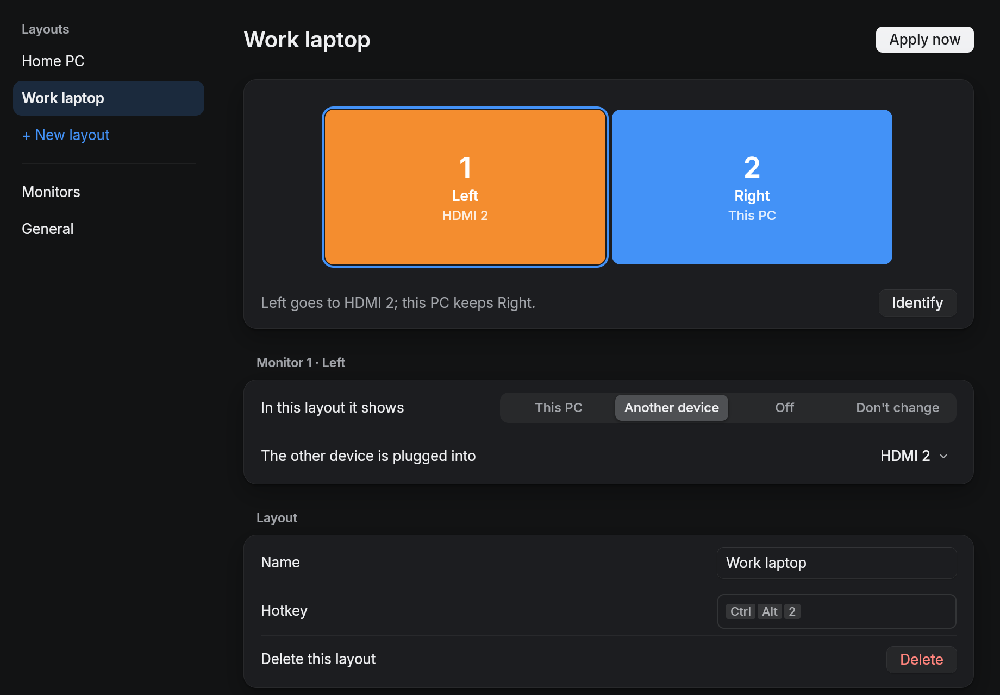
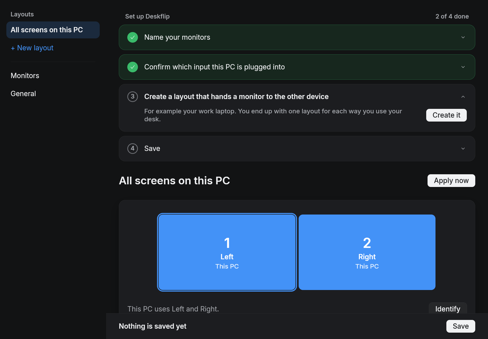

# Deskflip

[](https://github.com/nullopt/deskflip/actions/workflows/ci.yml)
[](LICENSE)

Share a monitor between your PC and another device (a work laptop, a console) and switch with one
key. Deskflip changes the monitor's input **and** tells Windows which monitors your PC still has,
so your windows move to the screens you can actually see.



Windows only. Deskflip lives in the system tray and keeps about 2 MB of private memory while it waits.

> Early release. It runs its author's desk every day, but it has been tried on few monitors.
> Please open an issue with the output of `deskflip monitors` if yours misbehaves.

## What it does

You describe each way you use your desk as a **layout**. For every monitor a layout says one of:

| In this layout the monitor shows | What Deskflip does |
|---|---|
| This PC | Switches the monitor to the PC's input and adds it to the desktop |
| Another device | Switches the monitor to that input and removes it from the desktop |
| Off | Removes it from the desktop, input untouched |
| Don't change | Nothing |

Apply a layout from the tray menu, a global hotkey, or the command line. If a switch fails half
way, Deskflip puts the monitors back the way they were.

A typical desk with two monitors and a work laptop on the left one has two layouts: *Home PC*
(both monitors on the PC) and *Work laptop* (left monitor to HDMI 2, PC keeps the right one).

## Install

1. Download `deskflip.zip` from the [Releases page](https://github.com/nullopt/deskflip/releases)
   and unzip it anywhere.
2. Run `deskflip.exe`. Windows may warn that the file is unsigned; choose *More info*, then
   *Run anyway*.
3. The settings window opens with a short checklist.



## Set up

1. **Name your monitors.** *Identify* shows each monitor's number in its corner.
2. **Confirm which input your PC is plugged into** on the monitor you share. Read it off the
   label on the port at the back of the monitor. Deskflip will not hand a monitor to another
   device until you have, because a wrong value would leave no way to bring the monitor back.
   *Test for 5 seconds* proves switching works before anything depends on it.
3. **Create a layout** that hands the monitor over. *Create it* in the checklist does this in
   one click.
4. **Save.** Give each layout a hotkey if you like, and turn on *Start with Windows* on the
   General page.

Settings live in `%APPDATA%\Deskflip\config.toml`, a plain file you can read and edit.

## Command line

The same exe works from a terminal, a Stream Deck, or AutoHotkey:

```
deskflip apply <layout>   Switch to a layout
deskflip list             List layouts; * marks the one in effect
deskflip settings         Open the settings window
deskflip monitors         List connected monitors and what they report
```

With no command, Deskflip runs in the system tray. A log is kept at
`%LOCALAPPDATA%\Deskflip\deskflip.log`.

## Limitations

- **The monitor must support DDC/CI**, and have it enabled in its own on-screen menu. Without
  it Deskflip cannot switch inputs, though it can still turn the monitor on or off for the PC.
- **Laptop panels and many USB or DisplayLink docks** do not pass DDC/CI.
- **A monitor that disappears from Windows** while it shows another device cannot be switched
  back by the PC. Use the monitor's own input button once, then check its settings for an
  option that keeps the PC's port awake.
- **Monitors are identified by the graphics-card port they are plugged into.** Swapping cables
  between ports makes them new monitors; name and confirm them again.
- **Deskflip cannot see what a monitor is showing**, so it cannot react when you plug the laptop
  in. Monitors report their PC input even while displaying another one.
- **Hotkeys are recorded by key position and named as on a US keyboard.** On another keyboard
  layout the field can show a different letter from the one you pressed; the key it shows is
  the one that works.
- The settings window draws with the GPU (DirectX 12). The tray icon does not.

## Build from source

```
cargo build --release
```

Needs stable Rust and the Windows SDK. The first build takes several minutes: the settings
window is built with [Rune](https://github.com/anomalyco/rune), a pre-release toolkit that
Deskflip pins to an exact revision. The result is one file, `target\release\deskflip.exe`.

```
cargo test
cargo clippy --all-targets -- -D warnings
```

Debug builds can render any page to an image without opening a window, which is how the
screenshots above are made:

```
cargo run -- settings --snap layouts.png --scene desk --theme dark --scale 2
```

## Licence

MIT. See [LICENSE](LICENSE).
